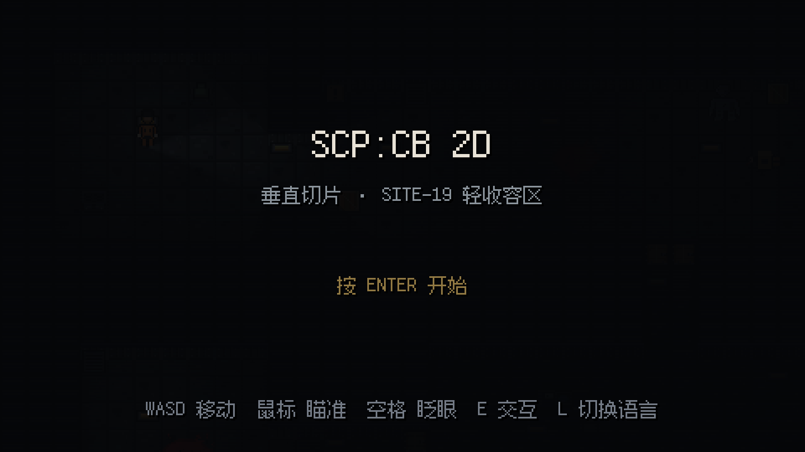
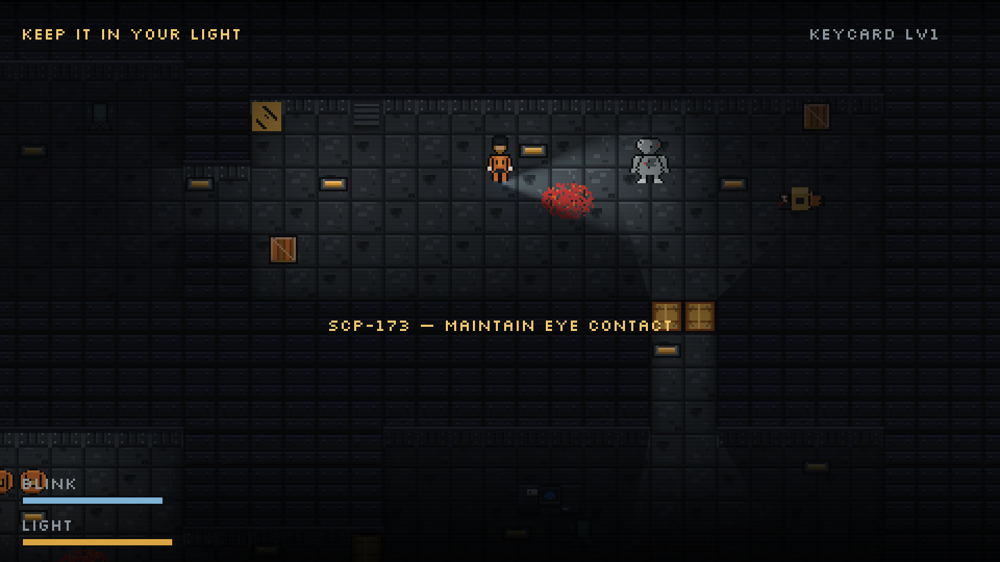
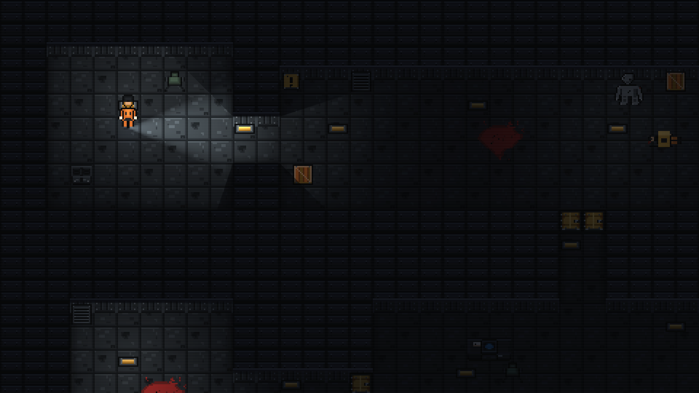
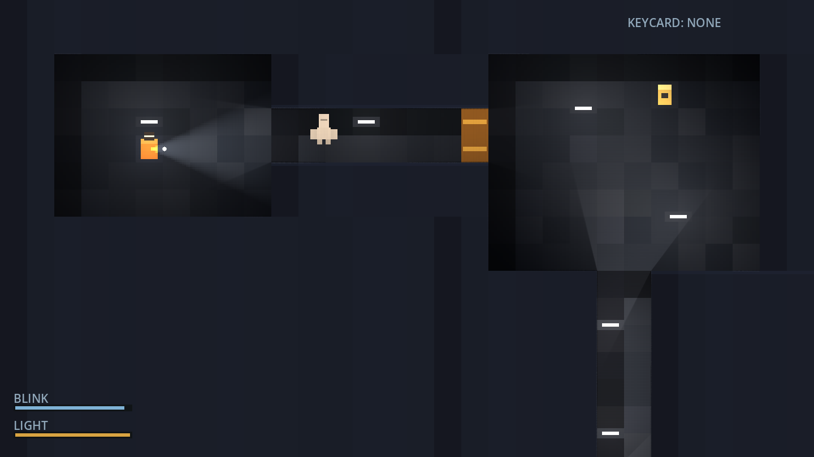

# SCP:CB 2D

把《SCP – Containment Breach》的体验做成**像素俯视 2D** 的免费同人游戏。开源、非商业。



*中文为默认语言，游戏内按 `L` 切换中英双语。*



*手电照住它，它不能动。关灯、眨眼、或者把光挪开——它就换位置了。*



*散落的日志是路线提示，也是这个世界唯一的解释。*



> 状态：**可玩 demo（垂直切片）**。只有一处手工搭建的设施区段，用于验证核心机制是否成立：黑暗里的手电、看不见就动的东西、会耗尽的眼睛。

## 现在这个 demo 里有什么

| 机制 | 实现 |
|---|---|
| 黑暗与光照 | 全场熄灭，只有顶灯光斑与手电锥形光；墙体真实遮挡光线 |
| 手电电量 | 最核心的资源，耗尽后你只能靠顶灯的余光活着 |
| "看见"判定 | **你在屏幕上看得到它**才算看见：视野内 ∧ 无遮挡 ∧（手电光锥内 ∨ 顶灯照到它）∧ 眼睛睁着 |
| SCP-173 | 没被看见时**瞬移式前进**：每 0.24 秒瞬间前移 40px（约 2.5 格），不滑行、不插值；被看见就完全冻结。接触即死 |
| 眨眼 | 22 秒强制眨眼 0.35 秒，期间全黑；可以提前按空格主动眨，把闭眼时机握在自己手里 |
| 门禁 | 1 级钥匙卡 → 开启走廊尽头的区域门 |
| 逃出 | 走到绿色逃生区即通关 |

还没有的：随机地图、多个 SCP、存档、声音、剧情。它们都在路线图里（见下）。

## 操作

| 键 | 动作 |
|---|---|
| `WASD` / 方向键 | 移动 |
| 鼠标 | 转动手电方向（**逃跑时可以把光留在身后**） |
| `Shift` | 冲刺（更快耗尽手电） |
| `空格` | 主动眨眼 |
| `F` | 开关手电 |
| `R` | 重开 |
| `Esc` | 退出 |

## 运行

需要 **Godot 4.7**（标准版，不需要 .NET 版）。

```powershell
# 本机已装好的路径
D:\software\Godot\4.7.2\Godot_v4.7.2-stable_win64.exe --path "C:\Users\Miyazawa i\Desktop\scp"
```

也可以在本目录双击 `play.cmd`。或者用 Godot 编辑器打开 `project.godot`，按 F5。

画面是 480×270 内部分辨率、16px tile、整数倍放大到 1440×810。

## 目录

```
project.godot          引擎配置（480×270、最近邻过滤）
main.tscn              唯一场景，节点由脚本生成
levels/act1.json       关卡数据：房间矩形、门、灯、道具、可拾取物、触发器、SCP 出生点
scripts/main.gd        关卡构建、流程、交互、HUD、存档
scripts/player.gd      移动、手电、眨眼、电量、体力、"看见"判定
scripts/scp173.gd      SCP-173 的凝视规则与瞬移步
scripts/ui.gd          全部界面（标题/暂停/文档/背包/死亡/结算）
scripts/i18n.gd        中英词条表（中文默认）
tools/check_encoding.py  中文文档编码自检
CONTEXT.md             术语表（这个项目里的词各指什么）
docs/design/           总体设计：剧情、四幕、beat 表、结局
docs/adr/              硬决策记录
docs/research/         原作系统与地图生成的逆向调研、素材来源登记
assets/                程序化生成的像素素材、音效、字体
art/_poc/              像素素材产线的可行性探针
```

## 自检开关

```powershell
# 关卡数据校验：道具是否都在可走格上、门两侧是否都可达、出口是否连通
Godot_v4.7.2-stable_win64.exe --path . --headless -- --validate

# 连通性检查
... -- --selftest

# 素材是否就位（缺图会自动降级，不会崩）
... -- --audit
```

## 设计上的四条硬约束

写在 `docs/adr/` 里，任何新提案都要先过这几关：

1. [俯视 2D + 光照遮蔽作为一等机制](docs/adr/0001-top-down-2d-with-light-occlusion.md)
2. [引擎用 Godot 4](docs/adr/0002-godot-4-gdscript.md)
3. [永不做战斗系统](docs/adr/0003-no-combat.md)
4. 承重系统只有五个：眨眼凝视、随机设施、钥匙卡权限攀升、黑暗与电量、SCP-106 的天灾追击

## 路线图

完整剧情、四幕结构、四个结局与内容预算见 **[docs/design/game-design.md](docs/design/game-design.md)**。

- [x] **Slice 0** 垂直切片：5 个房间、173、手电、眨眼、门禁、文档、存档、背包、体力
- [ ] **M1** 幕 I「苏醒」完整（10 个 beat，约 30 分钟）：房间模板数据化 → 关卡编辑器 → 幕 I 内容
- [ ] **M2** 幕 II「下潜」：106 追击、966、895、372、914
- [ ] **M3** 幕 III「夺权」+ 幕 IV「回程」（先做 8 分钟可验证版）+ 五个结局
- [ ] **M4** 打磨：音频设计、无障碍、中英校对

已锁定的三个决定：回程先做短版验证后再扩、第五个隐藏结局要做、MTF 只以声音与光影存在。

## 许可

- **代码**：MIT（见 `LICENSE`）
- **美术 / 文本 / 设计文档**：CC BY-SA 4.0（衍生自 SCP 基金会内容，见 `NOTICE.md`）
- 未使用原作任何代码与素材；未使用 SCP-173 的原型图像。

本项目是免费同人作品，与 SCP 基金会 wiki 的贡献者共享同一套世界观。SCP 基金会内容以 CC BY-SA 3.0 发布：https://scp-wiki.wikidot.com/licensing-guide
